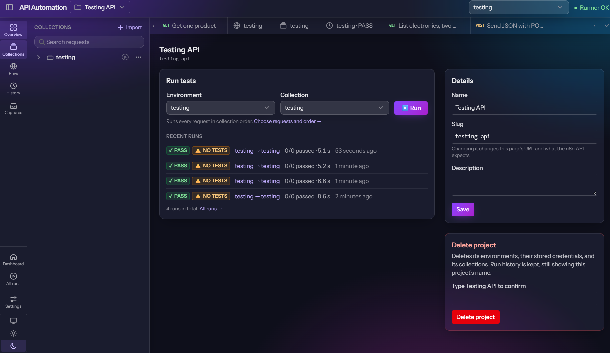
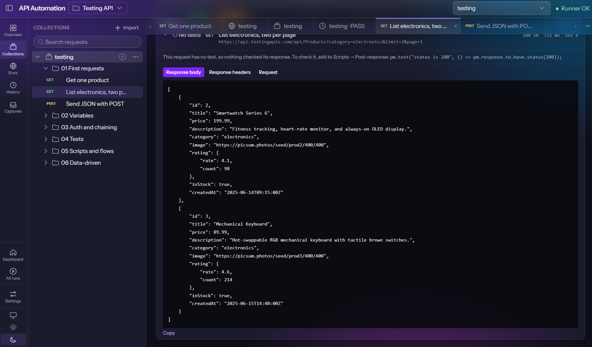
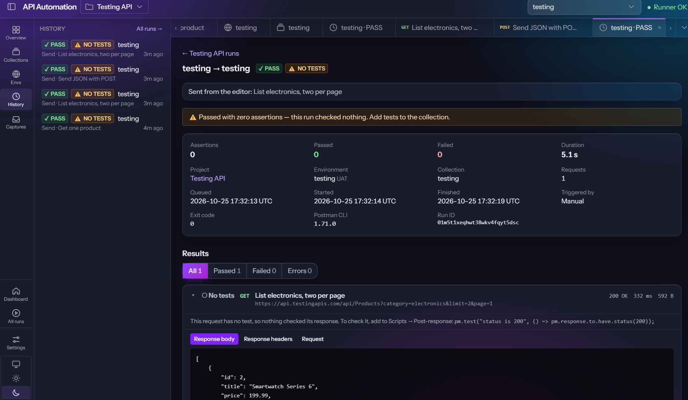
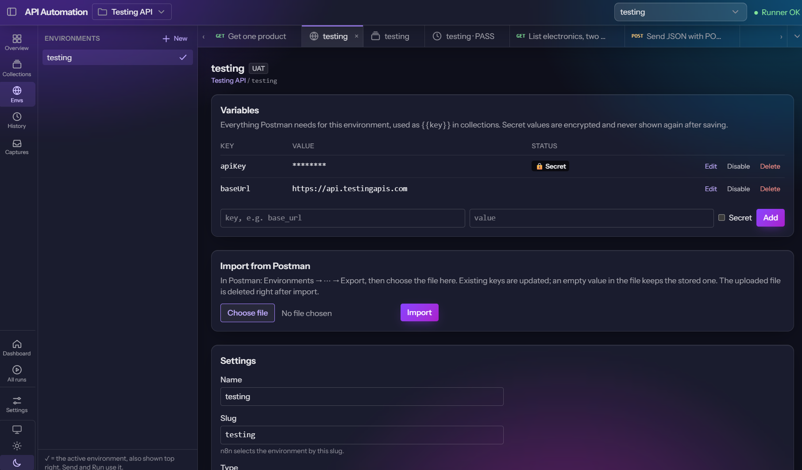
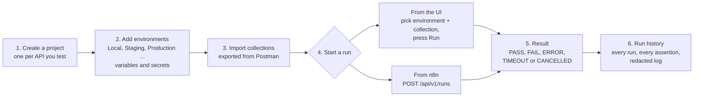
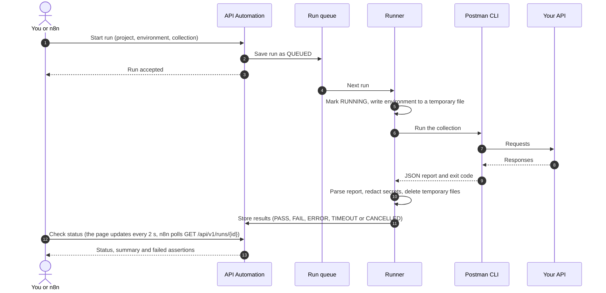

# API Automation

A project-agnostic control center for API integration testing.

One UI to manage API testing across several projects and environments: create a
project, define its environments, import a Postman collection, pick a target,
press Run, and read the result. Runs are stored so you can see what passed,
what failed, and why. Optionally, n8n can trigger the same runs on a schedule
or from a webhook.

## Quick start

You need Docker (Docker Desktop on Windows or macOS, Docker Engine with the
Compose plugin on Linux), about 4 GB of free memory, and port 8080.

```bash
git clone https://github.com/aj686/api-automation.git
cd api-automation
docker compose up -d
```

Compose downloads the ready-made images from the GitHub Container Registry
(`ghcr.io/aj686/api-automation`, published for every release); if it cannot,
it builds them from the `Dockerfile` instead (5–10 minutes). Then open
http://localhost:8080; the top bar shows **Runner OK** once the worker is up.

**First run:** create a project; add an environment and *Import from Postman*
`demo/environments/docker-compose.postman_environment.json`; on the
Collections tab import `demo/collections/api-automation-self-check.postman_collection.json`;
press **Run**. Expected: **PASS 6/6**.

| To | Run |
|---|---|
| use another port | `APP_PORT=9000 docker compose up -d` (or `APP_PORT=9000` in a `.env` file next to `docker-compose.yml`) |
| stop / start again | `docker compose stop` / `docker compose start` |
| update | `git pull && docker compose pull && docker compose up -d` (migrations run on start) |
| stay on one release | `API_AUTOMATION_VERSION=1.0.0 docker compose up -d` |
| build the images yourself (after changing code) | `docker compose up -d --build` |
| see the logs | `docker compose logs -f app worker` |
| enable the API for n8n | `docker compose exec app php artisan automation:token` |
| delete everything, data included | `docker compose down -v` |

**Testing an API on your own computer:** inside the containers, `localhost`
is the container itself. Use `http://host.docker.internal:<port>` as the base
URL, e.g. `http://host.docker.internal:3000`.

**No login.** The UI has no password, so the port is bound to `127.0.0.1` and
only your own computer can open it. Keep it that way unless you put your own
authentication in front.

Your data lives in two Docker volumes, `db` and `storage`. The application key
(which encrypts secret variables) and the API token are created on first start
and kept in `storage`.

## Screenshots

**Project overview** — pick an environment and a collection, press Run, see
recent runs.



**Request and response** — the collection tree on the left; a request sent from
the editor shows its response under it.



**Run detail** — status, counts, timings and every request with its response,
next to the run history.



**Environment** — variables for one environment; secrets are encrypted and
never shown again after saving.



## Objective

Testing an API by hand gets repetitive, and the credentials needed to do it end
up scattered across Postman apps, text files and shell history. This tool
solves three things:

1. **One place for credentials.** Each environment keeps all of its variables
   together — plain configuration like `base_url` next to secrets like
   `api_key`, clearly distinguished. Collections reference `{{base_url}}` and
   `{{api_key}}`; they never contain the values.
2. **Repeatable execution.** The same collection runs the same way every time,
   by hand or on a schedule, with results recorded rather than scrolled past.
3. **Answers, not terminal output.** The UI tells you which project,
   environment and collection ran, whether it passed, and which assertion
   failed — without reading raw CLI logs.

## What this is not

It does not replace the tools it drives. Postman Desktop stays the place to
author and debug collections. Postman CLI stays the thing that executes them.
n8n stays the scheduler. This application manages, runs, stores and displays —
nothing more.

It does have a request editor with **Send** and a Runner with **Run sequence**,
for convenience, but every request still runs in Postman CLI. There is no HTTP
client, test-scripting engine, variable engine, scheduler or execution engine
of its own.

## How it works

### The workflow

You set a project up once, then run it as often as you like, by hand or from
n8n. Every run ends up in the history with its full result.



### What happens during a run

A run never executes inside the request that starts it. Starting a run only
queues it. The runner picks it up, runs the collection with Postman CLI, and
stores the parsed result. The UI and n8n read that result back.



Variable values are stored encrypted. They are decrypted only to write the
temporary environment file for Postman CLI, which is deleted when the run
ends. Everything that is stored or shown (results, logs, captured requests)
is redacted first.

### Result statuses

An exit code alone never decides the outcome.

| Status | Meaning |
|---|---|
| `PASS` | Report parsed, no failed assertions |
| `FAIL` | Collection ran, at least one assertion failed |
| `ERROR` | Could not execute or could not parse the report |
| `TIMEOUT` | Exceeded the configured wall-clock limit |
| `CANCELLED` | Stopped on request, process confirmed gone |

Only Postman assertions decide pass or fail. An HTTP 401 is a pass if the test
expected 401; an HTTP 200 is a failure if the response body breaks an
assertion. A run that passes with zero assertions is flagged, not celebrated.

## Inbound and outbound

**Inbound** — the usual direction. Postman CLI calls the target API and asserts
on what comes back.

**Outbound** — for checking that your API correctly calls someone else. The
application exposes capture endpoints; you point the system under test at one,
trigger the action, then assert on the request that arrived.

```text
Postman triggers an action  ->  target API calls out  ->  capture endpoint here
                                                                  |
                            Postman polls for the captured call <-+
                                          |
                            assertions on method, URL, body, headers
```

Capture buckets are disabled by default, carry a random token in their URL, and
cannot be created for production environments.

## Security

- **No secrets in this repository.** `.env` is ignored; `.env.example` holds
  placeholders only. Imported collections and temporary environment files live
  outside version control.
- **Secrets at rest** use Laravel's encrypted casts. This protects a database
  dump, not a compromised machine.
- **Secrets to the CLI** are passed in a temporary file with restrictive
  permissions, removed once the run ends — not as command-line arguments,
  which would be visible in the process list.
- **Redaction** is applied before results are stored and before anything is
  displayed. It covers the known secrets of the environment used, plus common
  patterns such as authorization headers and cookies. It is best-effort for
  secrets the application was never told about.
- **Production** environments are badged, excluded from automation by default,
  and require explicit confirmation. Nothing runs on startup.
- **Execution** uses array arguments, never a shell string, and the executable
  path comes only from configuration.
- **Automation API** (`/api/v1`) is off until a token is generated; then it
  needs `Authorization: Bearer <token>` and is rate limited. Errors never
  include stack traces.
- **Capture URLs** carry a random token stored only as a hash, are disabled by
  default, record credential headers as `[present]` only, and cannot exist for
  production environments.

**Not protected:** anyone who can open the UI can do everything in it (there is
no login), and anyone with access to the machine can read the application key
and so decrypt the secrets.

## Advanced: run it inside an existing Docker stack

The [Quick start](#quick-start) is the easy way. This section is for adding the
app to a Docker stack you already run (shared nginx, MySQL, PHP-FPM), with the
code mounted from the host so you can develop on it.

The app is a plain Laravel app plus one queue worker that has Postman CLI
installed. It runs in any Docker setup that provides the pieces below. The
setup used to build it is described first, then what to copy into your own.

### The setup used here: docker-webstack on WSL

Developed and tested on **docker-webstack**, a shared Docker Compose stack for
several PHP projects, running in WSL 2 (Ubuntu) on Windows. Every project lives
under `~/docker-webstack/projects/`, which each container mounts as
`/var/www/projects`.

| Service (container name) | Image | Role for this app |
|---|---|---|
| `nginx` | `nginx:latest` | web server; loads every `projects/*/nginx.conf` |
| `php8.3.fpm` | own build from `php:8.3-fpm` | serves the UI, runs `artisan`, `composer` |
| `mysql` | `mysql:8.0.36` | the database (`api_automation` + `api_automation_testing`) |
| `api-automation-worker` | own build, see below | queue worker; the only place Postman CLI runs |
| `n8n` (optional) | `n8nio/n8n:2.42.6` | schedules runs through the API |

All on one Docker network (`docker_webstack`). Every published port is bound
to `127.0.0.1` because the UI has no login. Host name: `api-automation.local`.

```text
~/docker-webstack/
├── docker-compose.yml                  shared stack; the worker service is added here
└── projects/api-automation/            project folder (not in this repository)
    ├── nginx.conf                      vhost, auto-loaded by the nginx container
    ├── docker/worker/Dockerfile        worker image
    └── api-automation/                 this repository (Laravel app root)
```

The project-folder files are not versioned. Their contents are below, so you
can recreate them in any stack.

### What your Docker setup needs

| Piece | Requirement |
|---|---|
| PHP-FPM | PHP **8.3+** with `pdo_mysql`, `mbstring`, `intl`, `bcmath`, `zip` (plus Laravel's defaults); Composer |
| Web server | document root `public/`, every path not found passed to `index.php` |
| Database | MySQL 8, two databases; the test one's name must end in `_testing` |
| Worker | PHP 8.3 **CLI** with the same extensions + `pcntl`, **Node 22**, `postman-cli` **1.71.0** (pinned: the report parser is tested against this version) |
| Shared code | PHP-FPM and the worker mount the **same** app folder: uploaded collections are written by the web side and read by the worker from `storage/` |
| Network | PHP-FPM and the worker can both reach MySQL; the worker can reach the APIs you test |
| Node for assets | any container with Node to run `npm run build` once (the worker has it) |

Redis is not needed: the queue, cache and sessions use the database.

### 1. Worker image

`docker/worker/Dockerfile` (in your stack, anywhere you can build from):

```dockerfile
# Queue worker + Postman CLI. php:8.3-cli, not -fpm: this only runs artisan.
FROM php:8.3-cli

ENV TZ=Asia/Kuala_Lumpur
RUN ln -snf /usr/share/zoneinfo/$TZ /etc/localtime && echo $TZ > /etc/timezone

RUN apt-get update && apt-get install -y --no-install-recommends \
        ca-certificates curl git gnupg libicu-dev libzip-dev unzip zip \
    && rm -rf /var/lib/apt/lists/*

# pcntl lets queue:work handle SIGTERM, so `docker stop` does not orphan a run.
RUN docker-php-ext-configure pdo_mysql --with-pdo-mysql=mysqlnd \
    && docker-php-ext-install -j"$(nproc)" pdo_mysql pcntl bcmath zip \
    && docker-php-ext-configure intl --enable-intl \
    && docker-php-ext-install -j"$(nproc)" intl

# Node exists only because Postman CLI ships as an npm package.
ARG NODE_MAJOR=22
RUN curl -fsSL https://deb.nodesource.com/setup_${NODE_MAJOR}.x | bash - \
    && apt-get install -y --no-install-recommends nodejs \
    && rm -rf /var/lib/apt/lists/*

# Pinned: an unpinned CLI could change its report shape under the parser.
ARG POSTMAN_CLI_VERSION=1.71.0
RUN npm install -g postman-cli@${POSTMAN_CLI_VERSION} \
    && npm cache clean --force \
    && postman --version

# Match the owner of the bind-mounted files (your user on the host).
ARG UID=1000
ARG GID=1000
RUN groupadd -g ${GID} app && useradd -u ${UID} -g app -m app

USER app
WORKDIR /var/www/projects/api-automation/api-automation
```

Change `TZ` to your time zone and `UID`/`GID` to your host user (`id -u`, `id -g`).

### 2. Worker service

Add under `services:` in your `docker-compose.yml`. Paths are for the
docker-webstack layout; point `context` at the Dockerfile's folder and the
volume at the folder that holds this repository.

```yaml
    api-automation-worker:
        build:
            context: ./projects/api-automation/docker/worker
        container_name: "api-automation-worker"
        user: "1000:1000"
        restart: unless-stopped
        # Reaps the Postman CLI child processes that queue:work spawns.
        init: true
        working_dir: /var/www/projects/api-automation/api-automation
        command:
            - php
            - artisan
            - queue:work
            - database
            - --sleep=3
            - --tries=1
            # Must stay above AUTOMATION_RUN_TIMEOUT_SECONDS (300) in .env.
            - --timeout=360
        volumes:
            - "./projects/:/var/www/projects"   # same mount as your PHP-FPM service
        depends_on:
            - mysql
        networks:
            - docker_webstack                   # your stack's network
```

### 3. Nginx vhost

```nginx
server {
    charset utf-8;
    listen 80;
    server_name api-automation.local;

    root /var/www/projects/api-automation/api-automation/public;
    index index.php;

    client_max_body_size 32M;   # collection and environment uploads

    location ~ /\. {
        deny all;
    }

    location / {
        try_files $uri $uri/ /index.php$is_args$args;
    }

    location ~ \.php$ {
        internal;
        fastcgi_pass php8.3.fpm:9000;   # your PHP-FPM service name
        fastcgi_index index.php;
        fastcgi_param SCRIPT_FILENAME $document_root$fastcgi_script_name;
        include fastcgi_params;
    }
}
```

`/api/*` (bearer token) and `/capture/*` (URL token) need no extra blocks.
If your nginx protects other sites with basic auth, add `auth_basic off;` for
those two paths: n8n and the systems that call a capture URL cannot log in.

### 4. Database

As MySQL root (`docker exec -it mysql mysql -u root -p`), with your own
password in place of `YOUR_PASSWORD`:

```sql
CREATE DATABASE IF NOT EXISTS `api_automation`
    CHARACTER SET utf8mb4 COLLATE utf8mb4_unicode_ci;
CREATE DATABASE IF NOT EXISTS `api_automation_testing`
    CHARACTER SET utf8mb4 COLLATE utf8mb4_unicode_ci;

-- '%': the connection comes from another container, never 'localhost'.
CREATE USER IF NOT EXISTS 'api_automation'@'%' IDENTIFIED BY 'YOUR_PASSWORD';
GRANT ALL PRIVILEGES ON `api_automation`.*         TO 'api_automation'@'%';
GRANT ALL PRIVILEGES ON `api_automation_testing`.* TO 'api_automation'@'%';
FLUSH PRIVILEGES;
```

### 5. Install

Below, `$APP` is the app root inside the containers
(`/var/www/projects/api-automation/api-automation` here), `php8.3.fpm` your
PHP-FPM container, `api-automation-worker` the worker.

1. Clone this repository into the folder your containers mount.
2. In the app root: `cp .env.example .env`, then set `DB_PASSWORD`, and
   `DB_HOST` / `APP_URL` if your MySQL service or host name differ.
3. Install and migrate:
   ```bash
   docker exec -w $APP php8.3.fpm composer install
   docker exec -w $APP php8.3.fpm php artisan key:generate   # fresh install ONLY: a new key makes stored secrets unreadable
   docker exec -w $APP php8.3.fpm php artisan migrate
   ```
4. Start the worker: `docker compose up -d --build api-automation-worker`.
5. Build the front-end assets (needs Node; the worker has it):
   `docker exec api-automation-worker npm ci && docker exec api-automation-worker npm run build`.
6. Add the vhost and reload nginx: `docker exec nginx nginx -t && docker exec nginx nginx -s reload`.
7. Hosts file (Windows: `C:\Windows\System32\drivers\etc\hosts`):
   `127.0.0.1 api-automation.local`. Open http://api-automation.local. The
   top bar shows **Runner OK** once the worker is up.

Optional: `php artisan automation:token` enables the `/api/v1` API for n8n.

After changing PHP code, restart the worker (`docker restart api-automation-worker`):
`queue:work` keeps the old code in memory.

**No UI login.** Bind the web port to `127.0.0.1` (`"127.0.0.1:80:80"`), or
put your own authentication in front, before storing real credentials.

### Names to change if yours differ

The app itself does not depend on container names. These helpers do:
`scripts/browser-e2e.sh` (`php8.3.fpm`, network `docker-webstack_docker_webstack`),
the commands shown on the Settings page (`php8.3.fpm`), and the commands in
this README.

## Using it

1. **Projects → New project.**
2. **Environments** tab → create one (e.g. *Staging*) → add variables, or
   *Import from Postman* an exported environment. Mark credentials **secret**.
   From the runner container, `localhost` is the container itself: use
   `http://host.docker.internal:<port>` for an API on your computer, or the
   service name for another container (in docker-webstack: `http://nginx`
   plus a `Host` header).
3. **Collections** tab → import a Postman **v2.1** collection export.
4. **Overview** → pick environment and collection → **▶ Run**.
5. Open the run: status, every assertion, the redacted execution log. **Runs**
   lists history with filters.
6. Outbound: **Captures** tab → create and enable a capture URL, point the API's
   outgoing webhook/gateway URL at it (test environments only), assert in Postman.

`demo/` has a collection that tests this app itself (expected **PASS 6/6**),
with one environment file for the Quick start and one for docker-webstack, and
an outbound demo (`demo/README.md`).

## Testing

These need the development setup from the Advanced section; the Quick start
image is built without development dependencies.

```bash
docker exec -w $APP php8.3.fpm php artisan test              # unit + feature (real-CLI test skipped)
docker exec -w $APP api-automation-worker php artisan test   # everything, incl. a real Postman CLI run
sh scripts/browser-e2e.sh                                    # whole UI in real Chromium (from WSL)
```

Tests refuse to run unless the database name ends in `_testing`. Report parsing
is tested against real Postman CLI 1.71.0 output (`scripts/verify-postman-cli.sh`,
`tests/fixtures/postman`).

## Status

Version 1 is complete: projects, environments with encrypted secret variables,
Postman collection and environment import, a request editor with Send and Run
sequence, runs executed by Postman CLI in the worker (cancel, timeout,
recovery), run history with per-assertion results and a redacted log, the n8n
API (verified with n8n 2.42.6), and outbound capture.

Main known limit: the UI has no login, so keep it reachable from your own
computer only before you store real credentials.

## Licence

[MIT](LICENSE) © 2026 aj686
