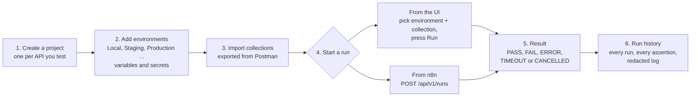
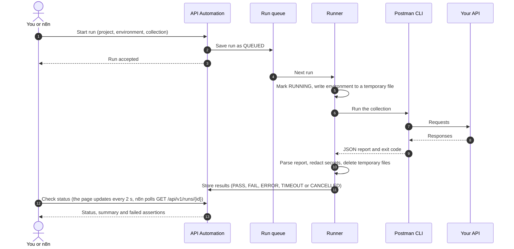

# API Automation

A project-agnostic control center for API integration testing.

One UI to manage API testing across several projects and environments: create a
project, define its environments, import a Postman collection, pick a target,
press Run, and read the result. Runs are stored so you can see what passed,
what failed, and why. Optionally, n8n can trigger the same runs on a schedule
or from a webhook.

## Objective

Testing an API by hand gets repetitive, and the credentials needed to do it end
up scattered across Postman apps, text files and shell history. This tool
solves three things:

1. **One place for credentials.** Each environment keeps all of its variables
   together — plain configuration like `base_url` next to secrets like
   `api_key`, clearly distinguished. Collections reference `{{base_url}}` and
   `{{api_key}}`; they never contain the values.
2. **Repeatable execution.** The same collection runs the same way every time,
   by hand or on a schedule, with results recorded rather than scrolled past.
3. **Answers, not terminal output.** The UI tells you which project,
   environment and collection ran, whether it passed, and which assertion
   failed — without reading raw CLI logs.

## What this is not

It does not replace the tools it drives. Postman Desktop stays the place to
author and debug collections. Postman CLI stays the thing that executes them.
n8n stays the scheduler. This application manages, runs, stores and displays —
nothing more.

So there is no request editor, no test-scripting engine, no variable engine, no
custom scheduler, and no custom execution engine.

## How it works

### The workflow

You set a project up once, then run it as often as you like, by hand or from
n8n. Every run ends up in the history with its full result.



### What happens during a run

A run never executes inside the request that starts it. Starting a run only
queues it. The runner picks it up, runs the collection with Postman CLI, and
stores the parsed result. The UI and n8n read that result back.



Variable values are stored encrypted. They are decrypted only to write the
temporary environment file for Postman CLI, which is deleted when the run
ends. Everything that is stored or shown (results, logs, captured requests)
is redacted first.

### Result statuses

An exit code alone never decides the outcome.

| Status | Meaning |
|---|---|
| `PASS` | Report parsed, no failed assertions |
| `FAIL` | Collection ran, at least one assertion failed |
| `ERROR` | Could not execute or could not parse the report |
| `TIMEOUT` | Exceeded the configured wall-clock limit |
| `CANCELLED` | Stopped on request, process confirmed gone |

Only Postman assertions decide pass or fail. An HTTP 401 is a pass if the test
expected 401; an HTTP 200 is a failure if the response body breaks an
assertion. A run that passes with zero assertions is flagged, not celebrated.

## Inbound and outbound

**Inbound** — the usual direction. Postman CLI calls the target API and asserts
on what comes back.

**Outbound** — for checking that your API correctly calls someone else. The
application exposes capture endpoints; you point the system under test at one,
trigger the action, then assert on the request that arrived.

```text
Postman triggers an action  ->  target API calls out  ->  capture endpoint here
                                                                  |
                            Postman polls for the captured call <-+
                                          |
                            assertions on method, URL, body, headers
```

Capture buckets are disabled by default, carry a random token in their URL, and
cannot be created for production environments.

## Security

- **No secrets in this repository.** `.env` is ignored; `.env.example` holds
  placeholders only. Imported collections and temporary environment files live
  outside version control.
- **Secrets at rest** use Laravel's encrypted casts. This protects a database
  dump, not a compromised machine.
- **Secrets to the CLI** are passed in a temporary file with restrictive
  permissions, removed once the run ends — not as command-line arguments,
  which would be visible in the process list.
- **Redaction** is applied before results are stored and before anything is
  displayed. It covers the known secrets of the environment used, plus common
  patterns such as authorization headers and cookies. It is best-effort for
  secrets the application was never told about.
- **Production** environments are badged, excluded from automation by default,
  and require explicit confirmation. Nothing runs on startup.
- **Execution** uses array arguments, never a shell string, and the executable
  path comes only from configuration.
- **Automation API** (`/api/v1`) is off until a token is generated; then it
  needs `Authorization: Bearer <token>` and is rate limited. Errors never
  include stack traces.
- **Capture URLs** carry a random token stored only as a hash, are disabled by
  default, record credential headers as `[present]` only, and cannot exist for
  production environments.

Details, and what is *not* protected: `docs/security.md` (project folder).

## Running it

Built for the `docker-webstack` stack on WSL (nginx, `php8.3.fpm`, MySQL 8, a
Docker network `docker_webstack`). Layout:

```text
~/docker-webstack/projects/api-automation/       project folder — NOT in this repository
├── nginx.conf          vhost api-automation.local (auto-loaded by webstack nginx)
├── docker/worker/      worker image: php:8.3-cli + Node 22 + postman-cli 1.71.0
├── docs/               setup, security, development, troubleshooting, n8n, decisions
└── api-automation/     this repository
```

The project-folder files are kept on the machine, not in Git. On a fresh setup:

1. Clone this repository as `~/docker-webstack/projects/api-automation/api-automation`
   and put the vhost and worker files in the project folder.
2. Create the databases and user — `docs/setup-mysql.md`.
3. In the app root: `cp .env.example .env` and fill in `DB_PASSWORD`. Then
   (`APP=/var/www/projects/api-automation/api-automation`):
   ```bash
   docker exec -w $APP php8.3.fpm composer install
   docker exec -w $APP php8.3.fpm php artisan key:generate   # fresh install ONLY — see security.md
   docker exec -w $APP php8.3.fpm php artisan migrate
   ```
4. Add the `api-automation-worker` service to `~/docker-webstack/docker-compose.yml`
   and start it: `docker compose up -d --build api-automation-worker`.
5. Build the front-end assets in the worker (the only container with Node):
   `docker exec api-automation-worker npm ci && docker exec api-automation-worker npm run build`.
6. Windows hosts file: `127.0.0.1 api-automation.local`. Open http://api-automation.local.

Optional: `php artisan automation:token` for n8n (`docs/n8n.md`).

## Using it

1. **Projects → New project.**
2. **Environments** tab → create one (e.g. *Staging*) → add variables, or
   *Import from Postman* an exported environment. Mark credentials **secret**.
   From the runner container, sites in the same webstack are reached as
   `http://nginx` plus a `Host` header — not `localhost`.
3. **Collections** tab → import a Postman **v2.1** collection export.
4. **Overview** → pick environment and collection → **▶ Run**.
5. Open the run: status, every assertion, the redacted execution log. **Runs**
   lists history with filters.
6. Outbound: **Captures** tab → create and enable a capture URL, point the API's
   outgoing webhook/gateway URL at it (test environments only), assert in Postman.

`demo/` has a collection and environment that test this app itself (expected
**PASS 6/6**) and an outbound demo (`demo/README.md`).

## Testing

```bash
docker exec -w $APP php8.3.fpm php artisan test              # unit + feature (real-CLI test skipped)
docker exec -w $APP api-automation-worker php artisan test   # everything, incl. a real Postman CLI run
sh scripts/browser-e2e.sh                                    # whole UI in real Chromium (from WSL)
```

Tests refuse to run unless the database name ends in `_testing`. Report parsing
is tested against real Postman CLI 1.71.0 output (`scripts/verify-postman-cli.sh`,
`tests/fixtures/postman`). See `docs/development.md`.

## Status

Version 1 is complete: projects, environments with encrypted secret variables,
Postman collection and environment import, runs executed by Postman CLI in the
worker (cancel, timeout, recovery), run history with per-assertion results and
a redacted log, the n8n API with an example workflow verified in n8n 2.42.6,
and outbound capture.

Known limits are listed in `docs/security.md` and `docs/architecture.md`;
notably, the UI has no login, so do not store real credentials while port 80
is reachable from other devices on your network.

## Documentation

In the project folder's `docs/`: `setup-mysql.md`, `architecture.md`,
`security.md`, `development.md`, `troubleshooting.md`, `n8n.md` (API contract
and workflow), `decisions.md` (every decision and how it was verified).

## Licence

No licence chosen yet. All rights reserved by default.
